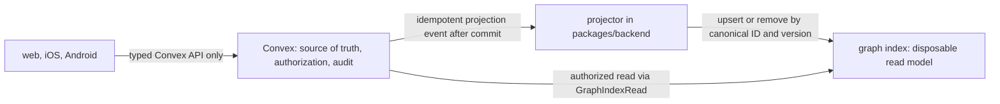
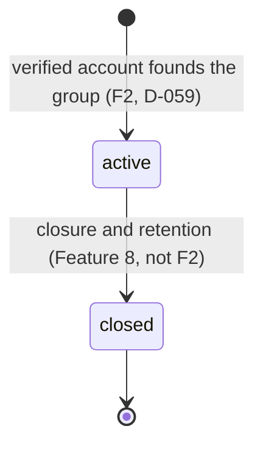
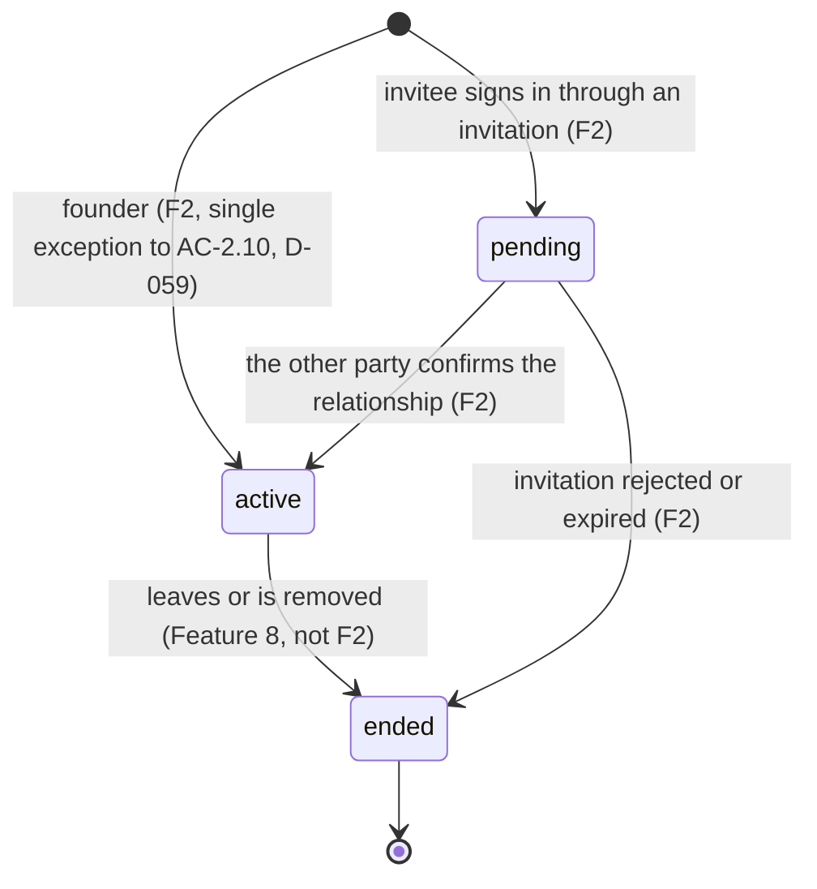
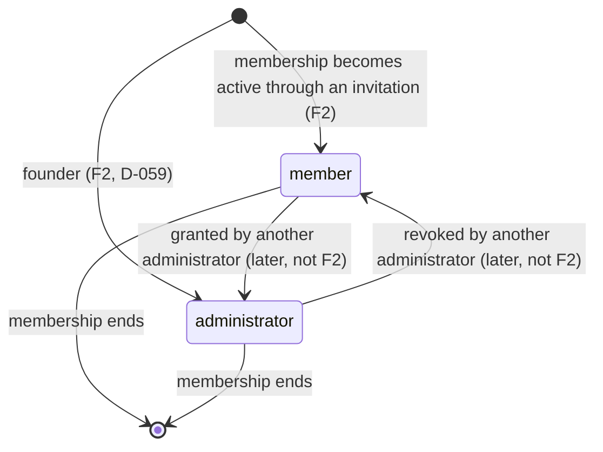
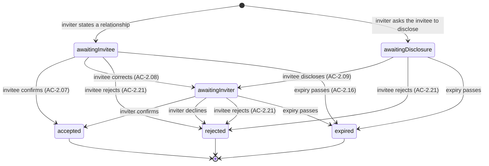

# Domain Model: People, Relationships, Kinship, Verification

## Canonical identity

`Person` represents one real individual. Names, name variants, relationships, memories, and evidence are related records, not reasons to create duplicate people. Duplicate resolution must be reviewed and preserve provenance.

## Relationship graph

Store relationships as typed edges between canonical person IDs. The model must support parent-child and spouse/partner edges and leave room for other explicitly supported relationship types. Do not store only `relation_to_current_user`, because the same person has different relations from different viewpoints.

All valid paths must remain available. A marriage between relatives can cause a person to be related through maternal and paternal branches at once; this is legitimate, not necessarily a data error.

### Optional graph index (Feature 3 readiness)

Feature 3 may add a graph database as an index beside Convex. This section defines only the seam: it adds no schema, dependency, deployment, or client behavior, and leaves the Feature 3 edge model, traversal limits, duplicate-merge workflow, and index choice open. Adding an index is a separate decision, and its provider and dependency need owner approval before use. Convex stays the only system of record for people, edges, states, and approvals.

#### Who owns what

| Concern | Owner |
|---|---|
| Canonical entity types, relationship types and states, graph validation (self-edge, ancestry cycle, spouse of an ancestor or descendant), who may confirm a stated relationship, capability rules | `packages/domain`, pure TypeScript |
| Walking accepted paths and deriving kinship labels, with the paternal-side default | `packages/kinship-engine`, pure TypeScript |
| Persistence, authorization, transactions, audit events, projection | `packages/backend` (Convex) |
| Path and neighbour lookup over an optional index | the graph index, behind one read-only port |

The index owns no rule. A decision made in `packages/domain` is never replaced by a graph query, and `packages/kinship-engine` derives labels from a returned path, never from a stored label or a provider's query language.

#### The read-only port

A graph index is reached only through one port, `GraphIndexRead`, implemented by an adapter in `packages/backend`:

- `paths(fromPersonId, toPersonId, { maxDepth, maxPaths })` returns the accepted edges forming each path plus a `truncated` flag, and never searches past the configured limits (AC-3.07).
- `neighbors(personId, { edgeTypes, maxResults })` returns adjacent accepted edges for expansion screens and duplicate checks.
- `health()` reports whether the index is populated and fresh enough to answer reads.

Port rules:

- Inputs and outputs use canonical person IDs and domain types from `packages/domain`. No graph-provider type crosses the port.
- A result carries edge IDs, endpoint IDs, edge type, relationship state, family group ID, and a source version. It carries no names, contact details, addresses, story text, evidence, or media keys.
- The port is read-only: no upsert, delete, label, approval, raw-query, or arbitrary traversal method. Application code cannot change family data through it or skip a Convex mutation.

#### One-way feeding

Convex commits, then a projector in `packages/backend` feeds the index. Feeding uses a separate internal projection interface, never the read port. Only accepted direct edges are projected: pending, rejected, and otherwise unaccepted edges never enter the index, and a transition out of `accepted` removes the indexed edge. The index is rebuildable from Convex alone, so index content that does not match these rules is wrong, not merely stale.

- The mutation commits and writes its audit event first. A client never writes to the index, and the index never triggers a Convex mutation.
- Projection events are idempotent and versioned, so retries, replays, and a full backfill from Convex produce the same index. The index is disposable and can be rebuilt from empty; removing an entry there deletes nothing in Convex.
- Index lag is expected. A read that must be current (confirmation, approval, merge validation) reads Convex. A path or neighbour read may use the index, and the response says when the index may be behind.
- A failed projection is retried and reported. It never blocks a Convex commit that already succeeded, and it never makes the index an authority.

Because a Convex query cannot call an external service, the adapter is invoked from a Convex action that authorizes the caller with an internal query first.

#### What must not leak

- The index is not a second source of truth: approval state, verification state, privacy decisions, and audit history are never stored or decided there as authority.
- Clients never reach the index directly. There is no public index endpoint or client credential, and neither `EXPO_PUBLIC_*` nor `NEXT_PUBLIC_*` may hold one. Every read passes a Convex function that authorizes the caller (AC-3.18 to AC-3.20), so a member of family group B cannot read group A edges through the index.
- Only identifiers and edge structure enter the index: no contact details, exact addresses, evidence, media keys, story text, invitation tokens, or Clerk identifiers. Index credentials and provider errors stay server-side and are never returned to users.
- `kin_stated` records are never projected as edges or paths (D-058). Sibling stays out of the edge model until Feature 3 decides it, and a derived label is never written back as a relationship fact.
- Pending and rejected edges are never projected. Their parties and reviewers read them from Convex, where the authorization rule is applied before anything is returned; the port never widens it.
- AI services never write the index and are never given raw index access.

### Stated relationships (D-058)

When an inviter states a relationship, or an invitee discloses one, it comes from a closed list in one of two forms, never free text:

- **Direct type**, stored as a typed edge: parent-child (one directed edge type) and partner. Sibling is decided with Feature 3's edge model.
- **`kin_stated`**, for supported non-direct terms such as cousin or uncle: a record of who stated what about whom, with its own relationship state. It is confirmed like a direct type but is not an edge, is never a graph path, and never produces a derived label until Feature 3 can derive and reconcile it.

A self-relationship, a stated edge that would make a person their own ancestor, and an unsupported term are rejected. A statement that conflicts with an established `accepted` relationship is not accepted by confirmation alone; it becomes a Feature 5 claim, and until Feature 5 exists it returns a fixed "needs review" result with no state change.

## Family groups, membership, roles, invitations

A family group is the unit of membership and access. Roles are scoped to one group (AC-2.28): a role in group A gives nothing in group B. Account state (D-003) is derived at call time from the verified identity and is never one of the states below. Every transition in this section writes an audit event in the same Convex mutation as the state change, and the backend rejects any transition not drawn here.

Feature 2 builds the transitions marked F2. The others are recorded so Feature 2 does not block them; they are built by the feature named.

### Family group

- Founding is rate limited (D-059). The founder's membership and administrator role are written in the same mutation as the group.
- One active group per account in Feature 2; the schema allows several memberships (D-059). Accepting an invitation to a second group while the account holds an active membership is refused (see Membership).

### Membership

- A pending member sees only their own profile, the pending invitation, and the inviter's display name (AC-2.22). They cannot invite, propose claims, or review (AC-2.24), and direct backend calls for anything else are denied (AC-2.23).
- `pending` to `active` happens in the same mutation that accepts the invitation and writes the edge or `kin_stated` record.
- An ended membership is never reactivated; joining again takes a fresh invitation.
- An account with an `active` membership cannot accept an invitation to another group (D-059). The attempt is refused with a fixed message that names no group and reveals no member data, nothing changes, and the invitation stays `pending` until it expires or is declined. There is no leave-and-switch, multi-group, or transfer behavior in Feature 2.

### Role

Roles attach only to an `active` membership; a pending membership has no role.

- Reviewer, contributor, and guardian roles (`docs/privacy-and-governance.md`) are added by Features 5, 7, and 8.
- Administrator gives no blanket access to private records (`docs/privacy-and-governance.md`). Nobody grants a role to themselves.
- Granting, revoking, and the rule for the last administrator of a group are decided before they are built.

### Invitation

- `awaitingInvitee`, `awaitingDisclosure`, and `awaitingInviter` are the sub-states of `pending` (AC-2.06). Only the other party to the invitation confirms: never the person who made the last statement (AC-2.26) and never a third party (AC-2.25).
- `accepted` writes the typed edge or `kin_stated` record with relationship state `accepted`, activates the membership, and writes the audit event, all in one mutation. `rejected` and `expired` create no edge or record (AC-2.21).
- Re-inviting the same contact to the same group while pending refreshes the invitation and restarts its expiry instead of creating a second one (AC-2.20). Expiry is 14 days and the limits are in config (D-061).
- `accepted`, `rejected`, and `expired` are terminal. Using the link of a terminal invitation is rejected with no state change (AC-2.16, AC-2.17); a fresh invitation is a new record.
- A confirmation that conflicts with an established `accepted` relationship leaves the invitation where it is and returns the fixed "needs review" result (AC-2.31, D-058).
- Accepting while the accepting account already holds an active membership in another group is refused with a fixed, non-revealing message; the invitation stays `pending` (D-059).
- Feature 2 sends invitations by email only; the invitation records its `channel` (D-060). The accepting account must have verified the invited contact (AC-2.19, D-066).

## Kinship terminology

Kinship terms are derived from graph paths plus locale/custom configuration. The default display preference favors the paternal-side label when several valid labels apply, unless the viewer has chosen another valid label. The preferred label is a presentation setting, never the source of truth for the graph.

Terminology records should support:
- language and script
- region or cultural context
- relationship-path pattern
- term and optional explanatory text
- source/reviewer and validation status
- fallback behavior when no term is known
- user-selected preferred label

The initial term catalogue needs validation by native speakers and families. Do not assume one Telugu vocabulary is universal across regions or households.

## Independent verification dimensions

- Account: control of email/phone or identity provider.
- Relationship: whether a claimed connection is accepted.
- Historical claim: evidence status for a field or assertion.
- Content: whether a story is approved for family publication.
- Profile: overall lifecycle status, which must not erase field-level uncertainty.

## Relationship claims and changes

A claim has a subject, predicate/type, object, proposer, state, evidence references, reviewer decisions, timestamps, and resolution. Sensitive changes preserve previous values and must not be overwritten silently.

Close-relative reviewers should be eligible for the claim being reviewed. Proposers cannot approve their own changes. Eligibility circles and thresholds for each of these are owned by D-023 and `docs/acceptance-criteria.md`:
- a newly invited person's self-confirmed relationship
- a low-risk profile-field correction
- a change to an established parent-child relationship
- a change to an established marriage/partner relationship
- an uncertain historical claim

## Deceased profiles

Initial approval requires three eligible close relatives. If fewer than three eligible reviewers exist, two eligible approvals plus documentary evidence reviewed by those approvers is sufficient; with fewer than two, the profile remains pending (D-016). The proposer never counts. Record each review and its evidence references separately. Do not silently reduce the threshold beyond this rule.

## Evidence

Preferred order:
1. Relevant documents or certificates.
2. Multiple independent testimonies if documentary evidence is unavailable.
3. Explicit uncertain/disputed status if evidence is insufficient or conflicting.
4. Administrator resolution with recorded rationale when escalated.

An uploaded document is evidence to assess, not automatic proof of authenticity. Evidence visibility is restricted to authorized reviewers and follows retention/deletion policy.

## Memories and stories

- Memory: contributor's personal experience.
- Story: historical narrative that may make claims about other people/events.
- Draft: private to the contributor.
- In review: visible only to authorized reviewers and any explicitly permitted participants.
- Published: visible according to family/content permissions.
- Disputed: competing claims or versions are recorded.
- Archived/restricted: retained under documented policy with limited access.

A story dispute follows a 60-day resolution policy. Timer start, visibility, resolution, extension, notifications, and exceptions are defined in D-026.

## Why these rules exist

One-line reasons for the critical invariants in `AGENTS.md`, so a change that seems to simplify them is weighed against the harm they prevent.

- **One canonical identity per person:** duplicates split a person's memories, relationships and approvals across records, so no one sees the whole family picture.
- **Maternal and paternal paths both preserved:** marriages between relatives are real, and dropping either path erases a true relationship and changes derived labels.
- **Labels are display only:** a term varies by household, region and viewer, so if a label could edit the graph, a preference would silently rewrite family facts.
- **Separate verification states:** control of an account, an accepted relationship, evidence for a claim and an approved story are different facts, and one `verified` flag would let one stand in for another.
- **A proposer never approves their own change:** approval is only meaningful as an independent check by someone else.
- **Uncertainty never becomes certainty:** family history is often disputed or undocumented, and recording a guess as fact makes it look settled and hard to correct.
- **Server-side authorization:** a client can be bypassed by calling the backend directly, so contact details, evidence and media are protected only if Convex functions check access themselves.
